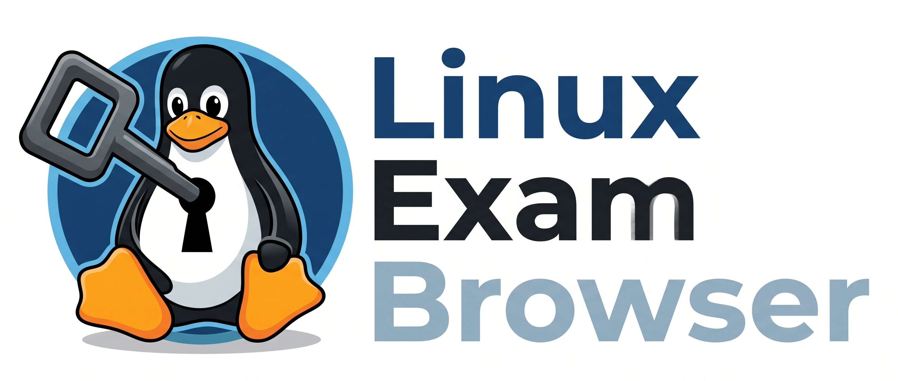

<p align="center">
  
</p>

# Linux Exam Browser (LEB)

A modern, native Safe Exam Browser (SEB) client for Linux built with C++20 and Qt6 WebEngine.

Linux Exam Browser allows students and test-takers to securely access Moodle and institutional Learning Management Systems (LMS) from any Linux distribution.

---

## Key Features

- **Full SEB Compatibility**:
  - Implements authentic Safe Exam Browser User-Agent verification.
  - Automatic cryptographic integrity headers (`X-SafeExamBrowser-ConfigKeyHash` and `X-SafeExamBrowser-RequestHash`).
  - Injects modern `window.SafeExamBrowser` JavaScript API for client-side LMS verification.
- **Versatile Configuration Parser**:
  - Supports Apple Plist XML and JSON `.seb` configuration files.
  - Supports password-protected encrypted configurations.
  - Dynamic canonical configuration key hashing.
  - URL filtering and kiosk/fullscreen security enforcement.
- **Universal AppImage**:
  - Self-contained executable with bundled Qt6 and QtWebEngine.
  - Runs out of the box on Ubuntu, Debian, Fedora, Arch Linux, Manjaro, openSUSE, Linux Mint, and more.
- **Seamless Desktop Integration**:
  - Adds launcher shortcut to your desktop application menu.
  - Registers MIME type associations to open `.seb` files with a single double-click.

---

## Quick Installation

Install Linux Exam Browser instantly on any Linux distribution with a single command:

```bash
curl -fsSL https://raw.githubusercontent.com/ridanXD/linux-exam-browser/main/install.sh | bash
```

The script automatically downloads the latest release, places the executable into `~/.local/bin/seb`, sets up file associations, and configures the desktop menu entry.

---

## Usage

### 1. Command Line Interface (CLI)

Pass your exam configuration file directly to `seb`:

```bash
seb <path-to-config.seb>
```

*(The `linux-seb` command alias is also supported)*

### 2. File Manager (GUI)

Simply **double-click** any `.seb` file downloaded from your university or school portal in Nautilus, Dolphin, Thunar, or PCManFM.

---

## Uninstallation

To remove Linux Exam Browser and its desktop shortcuts from your system:

```bash
rm -f ~/.local/bin/seb ~/.local/bin/linux-seb ~/.local/share/applications/linux-seb.desktop ~/.local/share/icons/hicolor/scalable/apps/linux-seb.svg ~/.local/share/mime/packages/x-safeexambrowser.xml
update-desktop-database ~/.local/share/applications/ 2>/dev/null || true
update-mime-database ~/.local/share/mime 2>/dev/null || true
```

---

## License

Distributed under the MIT License.
